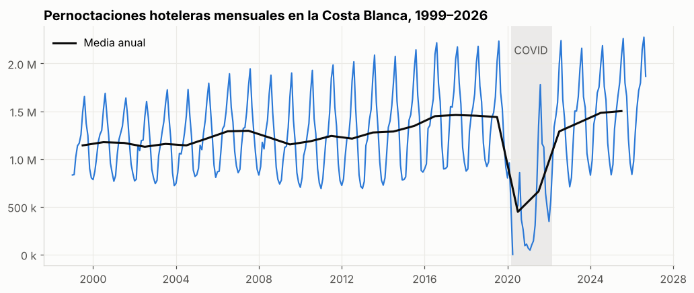

# Previsión de pernoctaciones hoteleras en la Costa Blanca

¿Cuántas pernoctaciones hoteleras tendrán Benidorm y la Costa Blanca en los próximos
1–12 meses, y qué factores lo explican?

> Estado: **fase 2 de 5 (análisis exploratorio)** completada.



## Hallazgos del análisis exploratorio

Detalle completo en [`notebooks/02_eda.ipynb`](notebooks/02_eda.ipynb).

- **Récord tras el COVID.** 2024 y 2025 superan el máximo anterior: 17,8 y 18,0 millones de
  pernoctaciones hoteleras, frente a 17,5 en 2017.
- **La temporada se concentra más, no menos.** Agosto pesaba 2,2 veces lo que enero en 2000–2004
  y pesa 3,25 veces en 2022–2025. Los inviernos siguen por debajo de 2019.
- **Cada vez más extranjeros:** el 61 % de las pernoctaciones en 2025, máximo de la serie. Su
  temporada va de mayo a octubre; la de los españoles se concentra en julio y agosto.
- **El crecimiento viene de fuera de Benidorm.** Benidorm tiene un 7 % más de pernoctaciones que
  en 2005; el resto de la Costa Blanca, un 70 % más.
- **Más plazas y estancias más cortas:** +56 % de plazas desde 1999 y una estancia media que baja
  de 5,8 a 3,8 noches.
- **Semana Santa** traslada unos 4 puntos de peso entre marzo y abril según el mes en que caiga.
- **COVID:** de marzo de 2020 a marzo de 2022.
- **Aeropuerto:** los pasajeros internacionales se relacionan con las pernoctaciones de extranjeros
  (0,52), pero Eurostat publica 3 meses después que el INE y con ese desfase la relación cae a 0,26.
- **Listón a batir:** "igual que el mismo mes del año pasado" tiene un error medio (MAPE) del
  4,8 % en 2015–2019 y del 4,6 % en 2024–2026.

## Datos

| Fuente | Ámbito | Desde | Series |
|---|---|---|---|
| INE · Encuesta de Ocupación Hotelera ([API JSON](https://www.ine.es/dyngs/DAB/index.htm?cid=1099)) | Costa Blanca (zona turística) | 1999-01 | viajeros y pernoctaciones (residentes en España / extranjero), establecimientos, plazas, ocupación por plazas y en fin de semana |
| | Benidorm (punto turístico) | 2005-01 | viajeros y pernoctaciones (España / extranjero), plazas, ocupación |
| | Provincia de Alicante | 1999-01 | viajeros y pernoctaciones (total, España, extranjero) |
| Eurostat · [avia_paoa](https://ec.europa.eu/eurostat/databrowser/view/avia_paoa/default/table) | Aeropuerto de Alicante-Elche | 2000-01 | pasajeros totales, nacionales e internacionales |
| Calculado | Calendario | 1999-01 | días de fin de semana, días de Semana Santa, mes de Pascua, periodo COVID |

Ninguna de las dos API necesita clave. Los códigos de cada serie están en `src/descarga.py`.

**Huecos y avisos conocidos:**
- Mayo y junio de 2020 vacíos en zona y punto turístico (hoteles cerrados), y febrero de 2021 en
  Benidorm. La provincia no tiene huecos. Abril de 2020 vale 0, no está vacío.
- Los meses del año en curso son provisionales y el INE los revisa al pasarlos a definitivos.
- Eurostat marca 2000–2003 como de baja fiabilidad y va unos 3 meses por detrás del INE.

## Uso

```bash
python -m venv .venv
.venv\Scripts\activate          # Mac/Linux: source .venv/bin/activate
pip install -r requirements.txt
python src/descarga.py          # descarga, valida y guarda
pytest                          # tests
jupyter notebook notebooks/     # análisis
```

Para añadir otro municipio o zona del INE, busca sus códigos y añádelos a `SERIES`:

```bash
python src/descarga.py buscar 2078 Torrevieja   # 2078 = puntos turísticos
python src/descarga.py buscar 2039 "Costa"      # 2039 = zonas turísticas
```

## Salidas

`data/turismo.duckdb` y `data/processed/*.csv`:

| Tabla | Contenido |
|---|---|
| `dataset_mensual` | **tabla para modelar**: una fila por mes con INE, aeropuerto y calendario |
| `eoh_mensual` | series del INE, una columna por serie, más totales y estancia media |
| `eoh_long` | INE en formato largo, con el tipo de dato (definitivo / provisional) |
| `aeropuerto` | pasajeros del aeropuerto de Alicante-Elche |
| `calendario` | días del mes, fines de semana, Semana Santa, mes de Pascua, marca COVID |
| `descargas` | registro de cada descarga (solo en DuckDB) |

`outputs/figuras/` guarda los gráficos del análisis y `outputs/baseline_ingenuo.csv` el error del
modelo de referencia.

## Estructura

```
├── data/          processed/ (CSV, incluidos para poder abrir el notebook sin descargar nada)
│                  raw/ (JSON originales) y turismo.duckdb se generan con descarga.py y no se suben
├── notebooks/     02_eda.ipynb · 03_baselines · 04_lightgbm (próximas fases)
├── src/           descarga.py
├── tests/
└── outputs/       figuras y métricas
```

## Fases

1. ~~Datos: descarga y validación~~
2. ~~Análisis exploratorio~~
3. Modelos de referencia: ingenuo estacional, SARIMA y ETS, con validación de origen móvil
4. LightGBM con retardos, calendario y aeropuerto; intervalos de predicción; interpretación con SHAP
5. App de previsión y sección en el portfolio
